# קו האש

משחק יריות ישראלי בדפדפן, בסגנון משחקי האקדח של הארקייד. תלת מימד, אמנות מצוירת, קולות בעברית.
מערכת ששת הימים: עשרה שלבים, 39 אזורים, מהמטווח בדרום ועד המוצב האחרון ברמה.

**לשחק עכשיו:** https://yontanbe.github.io/kav-haesh/

**איך בנינו את זה עם AI, בלי לכתוב קוד:** [המאמר המלא על קו האש ומבצע מדבר 1973](https://theailazyleader.com/he/blog/israeli-browser-games-ai-kav-haesh-1973-hebrew)

**משחק אחות:** [מבצע מדבר 1973](https://github.com/yontanbe/israel-rts-1973), אסטרטגיה בזמן אמת על מלחמת יום הכיפורים. [לשחק](https://yontanbe.github.io/israel-rts-1973/)

⭐ נהניתם? תנו כוכב לריפו (כפתור Star למעלה). זה עוזר לעוד אנשים למצוא את המשחק.

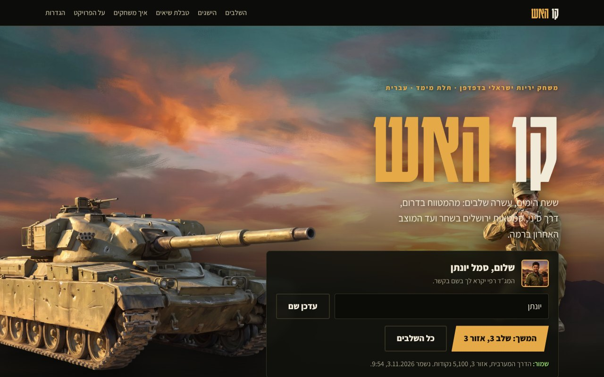

## צילומי מסך

| | |
|---|---|
| 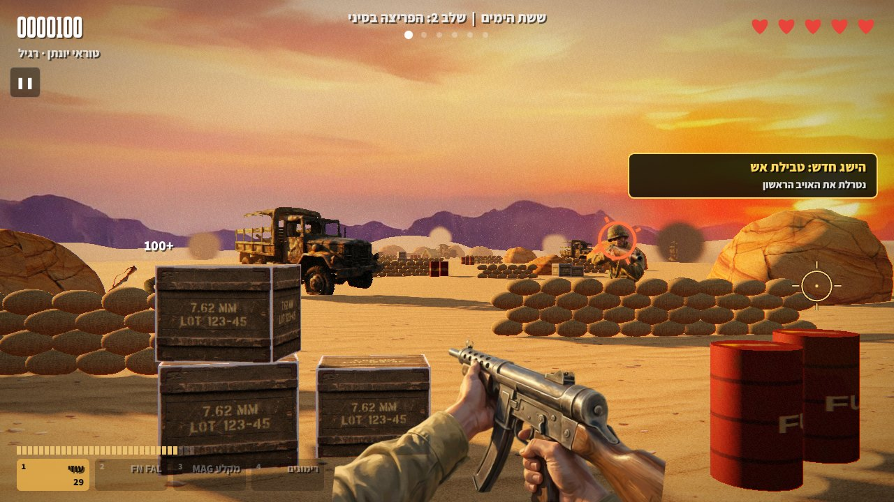 **הפריצה בסיני:** שקי חול, ארגזים שנשברים וחביות דלק | 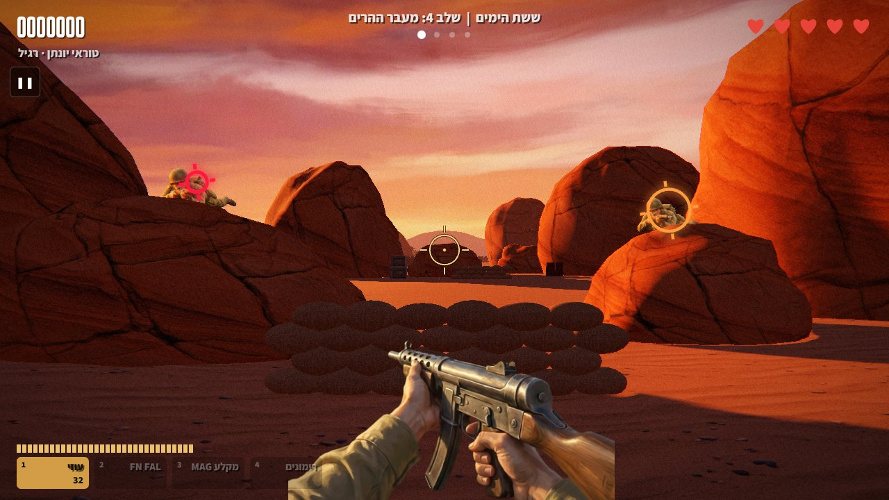 **מעבר ההרים:** קניון בשקיעה וצלפים על הסלעים |
| 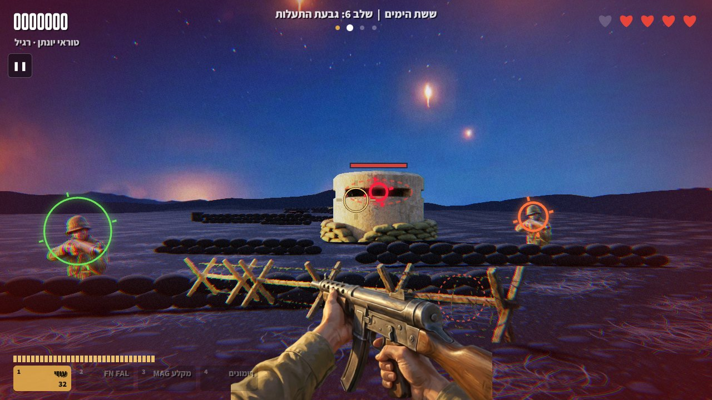 **גבעת התעלות:** לילה, תעלות, בונקר וזיקוקי תאורה | 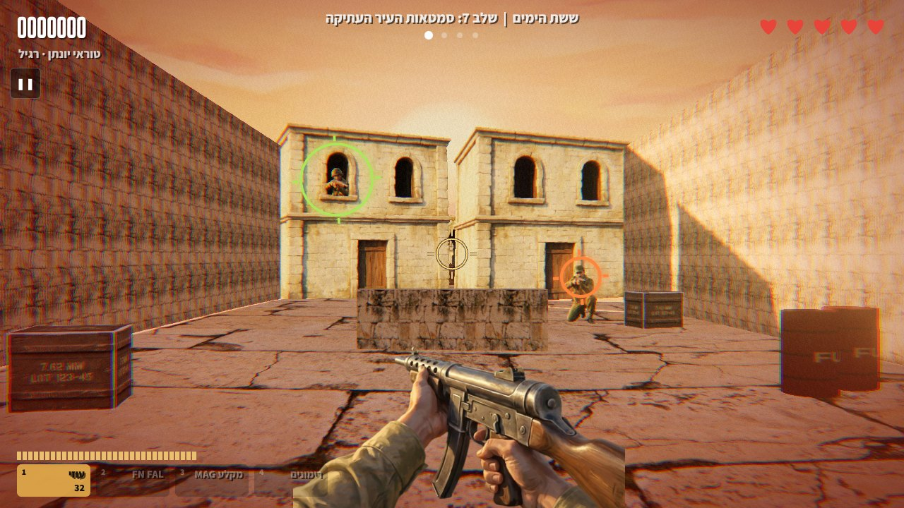 **סמטאות העיר העתיקה:** אויבים בחלונות ואזרחים בסמטה |
| 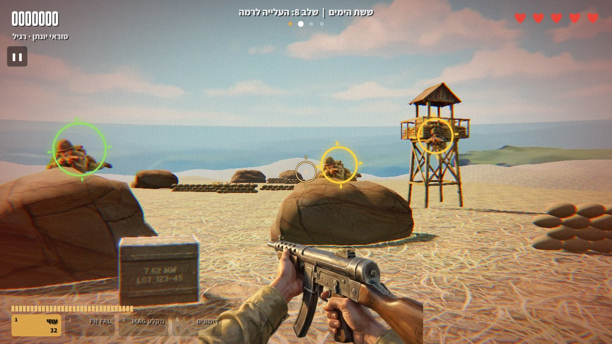 **העלייה לרמה:** בזלת, מגדל שמירה וצלפים | 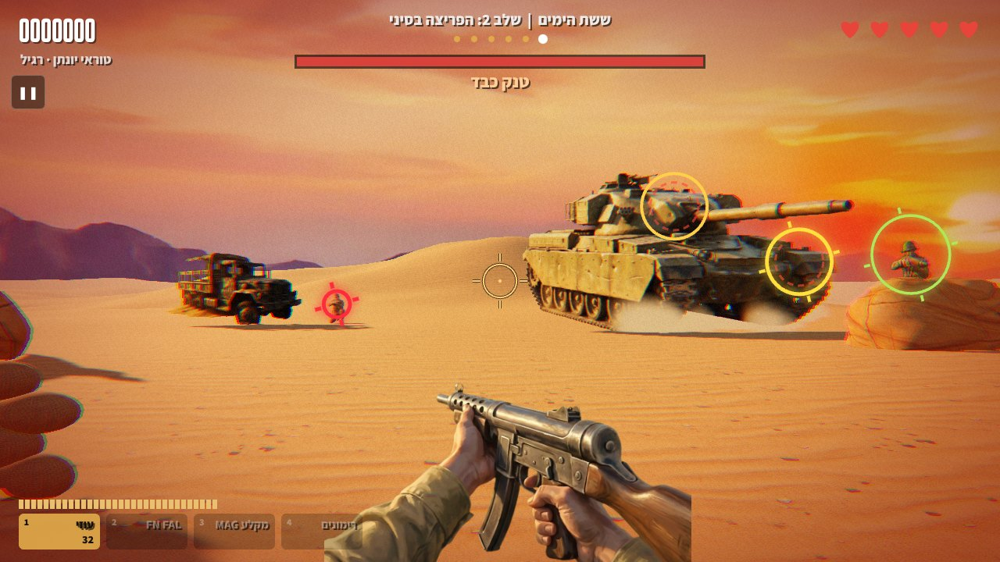 **בוס טנק:** צריח ומקלע הן נקודות התורפה |
| 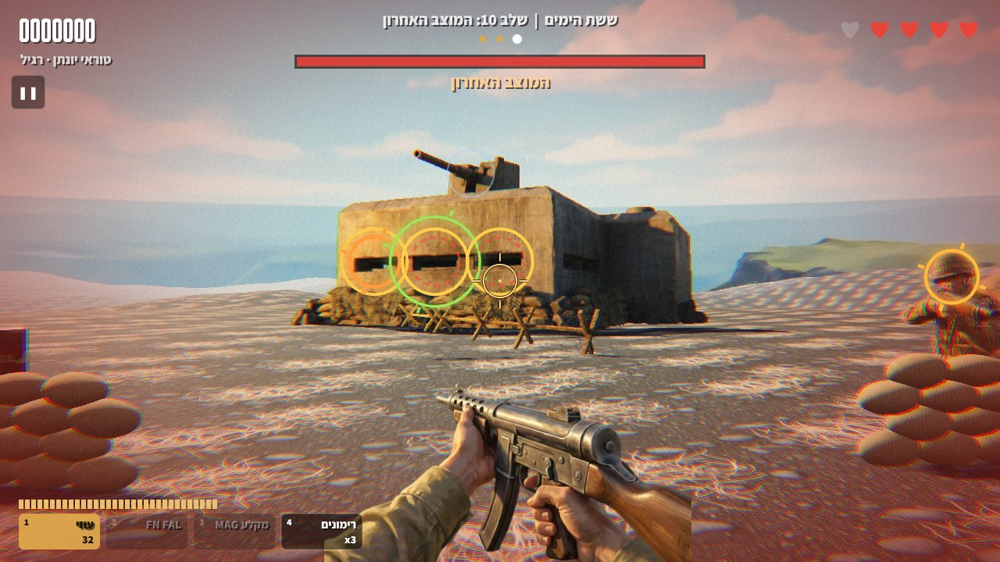 **המוצב האחרון:** שלושה חרכים ותותח על הגג | 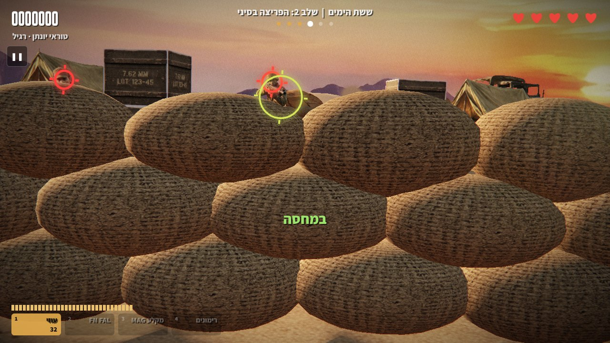 **מחסה:** מחזיקים רווח ומתכופפים מאחורי שקי החול |
| 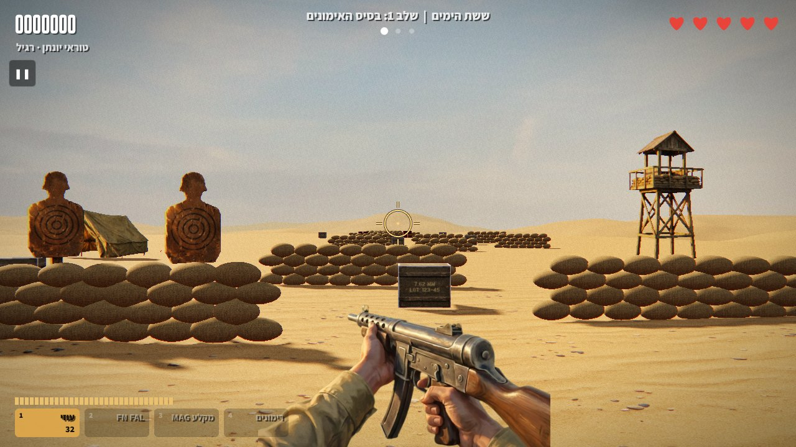 **בסיס האימונים:** מטרות קרטון, ובלבנות לא יורים | 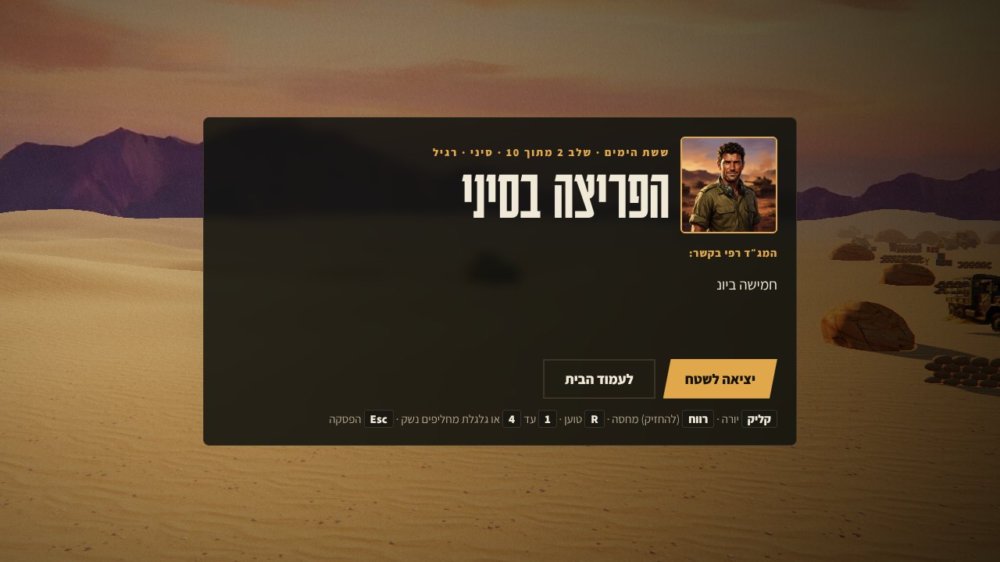 **תדריך:** המג״ד רפי לפני כל שלב |

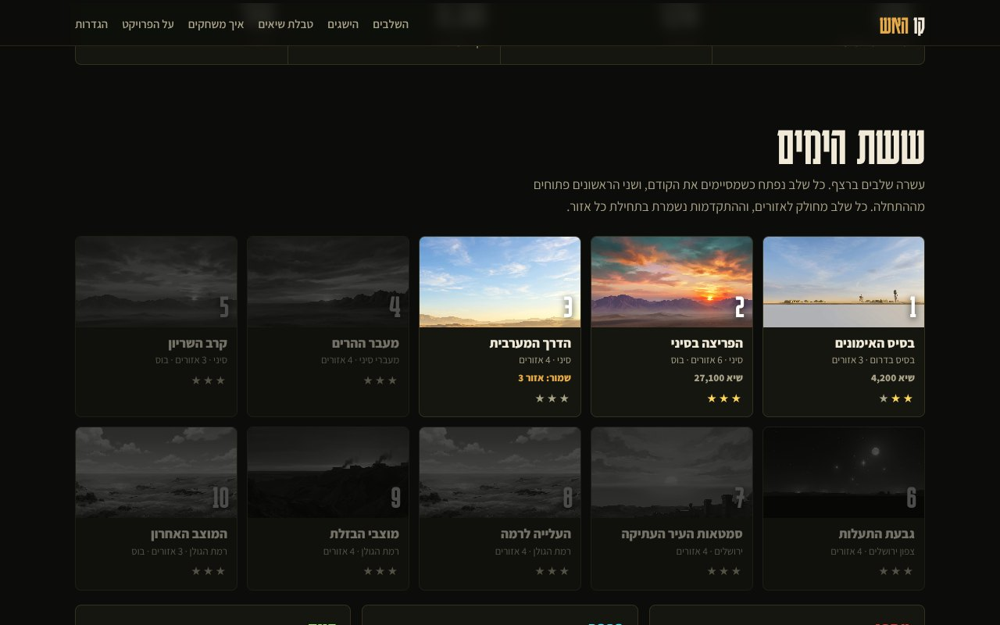

## איך משחקים

| | במחשב | בטלפון (לרוחב) |
|---|---|---|
| ירי | מכוונים עם העכבר וקליק | הקשה במקום שרוצים לפגוע |
| מחסה | להחזיק רווח | כפתור המחסה בפינה השמאלית: הקשה נועלת והקשה נוספת מקימה, או להחזיק |
| טעינה | R או קליק ימני. במחסה הנשק נטען לבד ומהר יותר | כפתור הטעינה בפינה הימנית, או להתכופף |
| החלפת נשק | 1 עד 4, גלגלת או Q | הקשה על משבצות הנשק |
| הפסקה ושמירה | Esc או P | הכפתור ❚❚ |

כמה טיפים:
- כשהטבעת סביב האויב נהיית אדומה, הוא עומד לירות. תתכופף או תירה ראשון.
- פגיעה בראש שווה פי שלושה. פגיעה ברגל מנטרלת חייל בלי להרוג אותו, ונותנת בונוס.
- ארגזים נשברים אחרי כמה פגיעות. חבית דלק מתפוצצת ומפילה את כל מי שעומד לידה.
- רימונים, פגזים של טנק ורימונים של האויב אפשר ליירט באוויר.
- בעיר העתיקה יש אזרחים. כל פגיעה באזרח עולה בחיים.
- חייל עם לב ירוק מעל הראש מפיל לב כשמחסלים או מנטרלים אותו. יורים בלב כדי לאסוף חיים. ברמה קלה זה קורה הרבה, ברגיל מדי פעם וברמה קשה לעתים רחוקות. כשהחיים מלאים הלב מוסיף משבצת חיים, עד 3 נוספות בקל, 2 ברגיל ו־1 בקשה.

## מה יש במשחק

**עשרה שלבים:** בסיס האימונים, הפריצה בסיני, הדרך המערבית, מעבר ההרים, קרב השריון, גבעת התעלות (לילה), סמטאות העיר העתיקה, העלייה לרמה, מוצבי הבזלת, והמוצב האחרון עם בוס.

- **ארבעה נשקים:** עוזי, FN FAL שחודר דרך כמה אויבים, מקלע MAG ורימונים. נשקים נוספים נאספים מארגזים בשטח.
- **אויבים:** חיילים שקופצים מאחורי מחסות, מקלענים, זורקי רימונים, רצים, קצינים, צלפים שוכבים, ג׳יפים, בונקרים, טנק ומבצר.
- **קולות בעברית:** המג״ד רפי בקשר בתחילת כל אזור, ואזרחים שצועקים לעזרה.
- **שמירה:** שם השחקן, רמת קושי, שיאים, כוכבים, 13 הישגים ונקודת ביקורת בתחילת כל אזור. אפשר לעצור באמצע ולהמשיך מאותו אזור.
- **רמות קושי:** קל, רגיל וקשה. בהגדרות יש גם מצב גרפיקה חסכוני לטלפונים ומחשבים חלשים.
- **אפליקציה:** בטלפון ובמחשב אפשר להתקין את המשחק למסך הבית (כפתור התקן כאפליקציה בעמוד הבית, או באייפון: שיתוף ואז הוסף למסך הבית). אחרי הביקור הראשון הוא נטען מהר ועובד גם בלי אינטרנט.
- **שיתוף:** בסוף כל שלב יש כפתור שיתוף עם הניקוד והכוכבים.
- **גרסה קלאסית:** `classic.html` היא הגרסה הראשונה של המשחק, בדו מימד, עם ארבע מערכות וארבעים שלבים.

## להריץ במחשב שלך

צריך רק Python (כבר מותקן ברוב המחשבים) ודפדפן.

```bash
git clone https://github.com/yontanbe/kav-haesh.git
cd kav-haesh
python3 -m http.server 8000
```

ואז לפתוח בדפדפן את http://localhost:8000

אי אפשר פשוט ללחוץ פעמיים על `index.html`: הדפדפן חוסם טעינה של תמונות וקולות מקובץ שנפתח ישירות, ולכן צריך את השרת הקטן.

## להעלות עותק משלך לאינטרנט

המשחק הוא קבצים סטטיים בלבד, בלי שרת ובלי בנייה, ולכן כל אתר אחסון סטטי מתאים. הדרך הפשוטה היא GitHub Pages, בחינם:

1. לוחצים **Fork** בראש העמוד הזה כדי ליצור עותק בחשבון שלך.
2. בעותק נכנסים ל־**Settings**, ואז **Pages**.
3. תחת **Build and deployment** בוחרים **Deploy from a branch**, ענף `main` ותיקייה `/ (root)`, ושומרים.
4. אחרי דקה או שתיים המשחק עולה בכתובת `https://<שם המשתמש שלך>.github.io/kav-haesh/`

אותו דבר עובד גם ב־Netlify, Vercel או Cloudflare Pages: מחברים את הריפו, בלי פקודת בנייה, ותיקיית הפרסום היא שורש הריפו.

## איך המשחק בנוי

```
kav-haesh/
├── index.html       עמוד הבית: שם, התקדמות, שלבים, הישגים, הגדרות
├── play.html        מסך המשחק. play.html?l=1 עד l=10
├── engine3d.js      מנוע התלת מימד: עולם, אויבים, ירי, בוסים, מסך
├── levels67.js      עשרת השלבים כנתונים
├── profile.js       שמירה בדפדפן, הגדרות והישגים
├── board.js         טבלת שיאים משותפת (פעילה רק בעמוד ב־claude.ai)
├── sw.js            שמירת הקבצים במטמון, להתקנה ולמשחק בלי אינטרנט
├── manifest.webmanifest  שם, אייקונים ומסך מלא כשמתקינים
├── og.jpg           התמונה שמופיעה כששולחים קישור
├── audio.js         אפקטים ומוזיקה מסונתזים בקוד
├── voices.js        רשימת הקלטות הקול
├── classic.html     הגרסה הקלאסית (data.js, art.js, game.js)
├── assets/          תמונות webp: שמיים, טקסטורות, דמויות, רכבים, נשקים
│   └── voice/       56 הקלטות mp3
├── vendor/          Three.js 0.147 ופוסט פרוססינג
├── tools/
│   └── key_sprites.py   הסרת רקע ירוק מהדמויות והמרה ל־webp
└── docs/screenshots/    צילומי המסך שבעמוד הזה
```

הדמויות הן ציורים שטוחים שתמיד פונים למצלמה, בתוך עולם תלת מימד אמיתי של דיונות, שקי חול, סלעים וקירות עם צללים. הפגיעה נבדקת לפי הפיקסלים של הציור עצמו, כך שירי בחלק שקוף לא נחשב, ומזהים ראש ורגליים לפי אזורים בתמונה.

## להוסיף שלב

כל שלב הוא אובייקט במערך שב־`levels67.js`, ואין צורך לגעת במנוע. דוגמה מקוצרת:

```js
{
  name: 'השלב שלי', place: 'סיני', sky: 'sky_day', ground: 'sand',
  brief: 'התדריך שמופיע לפני השלב, {name}.',
  debrief: 'מה שמופיע בסוף.',
  scenes: [
    {
      pos: [0, -4.5],                 // מיקום המצלמה בעולם [x, z]
      name: 'אזור ראשון',
      radio: 'מה שהמג״ד אומר בקשר',
      build: A => {                   // בונים בקואורדינטות מקומיות: x ימינה, d קדימה
        A.sb(-4, 9, 5, 4);            // שקי חול: x, d, אורך, שורות
        A.crate(2, 7, 1);             // ארגז
        A.barrel(3, 6);               // חבית דלק
        A.rock(9, 12, 1.6, 2.1);      // סלע
      },
      spots: [                        // מאיפה האויבים מופיעים
        { k: 'pop', x: -4, d: 9.8 },              // קופץ מאחורי מחסה
        { k: 'side', x: 2, d: 7.9, dx: 1.6 },     // יוצא הצידה
        { k: 'run', d: 18, x0: -14, x1: 14 },     // רץ לרוחב
      ],
      wave: ['soldier', 'soldier', 'grenadier', 'runner', 'heavy'],
    },
  ],
}
```

סוגי אויבים ל־`wave`: `soldier`, `heavy`, `grenadier`, `runner`, `officer`, `prone`, `win` (בחלון), `jeep`, `civ` (אזרח), `target` ו־`targetCiv` (מטווח), ו־`{ t: 'bunker', x, d }`.
בוס מוגדר בשדה `boss` של השלב: טנק (`type: 'tank'`) או מבצר (`type: 'fort'`).

## איך נוצרו האמנות והקולות

- **תמונות:** כל השמיים, הטקסטורות, החיילים, האזרחים, הרכבים, הבוסים והנשקים נוצרו במחולל התמונות Gemini. דמויות וחפצים נוצרו על רקע ירוק אחיד, והסקריפט `tools/key_sprites.py` מסיר את הרקע וממיר ל־webp.
- **קולות:** ההקלטות נוצרו בהקראה של Gemini, ונשמעות במשחק דרך מסנן שמדמה קשר צבאי.
- **סאונד ומוזיקה:** מסונתזים בקוד בזמן אמת עם Web Audio, בלי קבצי שמע.

## שמירה וטבלת שיאים

ההתקדמות נשמרת בדפדפן (localStorage), ולכן היא לא עוברת בין מכשירים, ומחיקת נתוני הגלישה מוחקת אותה.
טבלת השיאים המשותפת פועלת רק כשמשחקים דרך עמוד המשחק ב־claude.ai, שמספק לה מאגר נתונים. ב־GitHub Pages ובהרצה מקומית היא מוסתרת, וכל השאר עובד כרגיל.

## קרדיטים

- [Three.js](https://threejs.org) (רישיון MIT), נמצא בתיקייה `vendor/`
- הגופנים Karantina ו־Assistant מ־Google Fonts (רישיון SIL Open Font License)
- כל הדמויות, היחידות והגופים במשחק בדויים

## רישיון

הקוד ברישיון MIT, ראו `LICENSE`. המשחק בדיוני ובהשראה היסטורית: העלילה, הדמויות, היחידות והקרבות אינם מתארים אירועים או אנשים אמיתיים.
